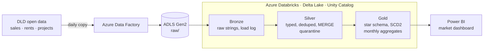

# Dubai Property Data Platform

[](https://github.com/salmantariq596/dubai-property-data-platform/actions/workflows/ci.yml)

An Azure lakehouse that turns official Dubai Land Department (DLD) sales and rental records into a market dashboard.

**The question it answers:** *Where in Dubai are prices rising fastest, what does a square foot cost by area and property type, and what rental yield can an investor expect?*

> 🚧 **Status: Module 1 of 10 — data discovery.** The platform is built in modules, each merged by pull request and tagged. See the [roadmap](#roadmap) and [CHANGELOG](CHANGELOG.md).

## Architecture



Data quality checks run between every layer. Terraform builds the infrastructure, Key Vault holds secrets, and GitHub Actions tests and deploys the code.

## Tech stack

| Layer | Tool | Why |
|---|---|---|
| Storage | Azure Data Lake Storage Gen2 | Standard Azure lake storage |
| Ingestion and scheduling | Azure Data Factory | Most-listed orchestration tool in Gulf data roles |
| Processing | Azure Databricks, PySpark | Distributed processing of 11M+ records |
| Table format | Delta Lake | ACID, MERGE, schema enforcement, time travel |
| Governance | Unity Catalog | Catalogs, permissions, lineage |
| Data quality | Custom rules + `dq_results` table | Bad data is quarantined or blocks the run |
| BI | Power BI | Dominant BI tool in the region |
| Infrastructure as code | Terraform | Whole platform rebuildable from code |
| CI/CD | GitHub Actions, Databricks Asset Bundles | Tested, automated deploys |

## Repository layout

```
├── src/dubai_property/   # all pipeline logic, unit-tested
│   ├── profiling/        # Module 1: data discovery
│   ├── bronze/ silver/ gold/ quality/ utils/
├── notebooks/            # thin notebooks that call src/
├── tests/                # unit/, integration/, fixtures/
├── infra/                # Terraform
├── adf/                  # exported Data Factory pipelines
├── powerbi/              # .pbix and PDF export
└── docs/                 # data sources, dictionary, decisions, profiles
```

## Quick start

```bash
git clone https://github.com/salmantariq596/dubai-property-data-platform.git
cd dubai-property-data-platform
make setup          # virtualenv, dev dependencies, pre-commit hooks
make test           # unit tests
make profile-sample # profile the synthetic fixture
```

Profile a real DLD download:

```bash
dld-profile data/raw/transactions/load_date=2026-11-04/transactions.csv \
    --key transaction_id --output docs/profiles/transactions.md
```

Use `--sample-rows 200000` for a quick first look at a multi-gigabyte file.

## Data

Official DLD open data only; no listing sites are scraped. See [docs/data_sources.md](docs/data_sources.md) for sources and caveats, [docs/data_dictionary.md](docs/data_dictionary.md) for columns, and [docs/business_questions.md](docs/business_questions.md) for what the dashboard answers. Raw data is never committed.

## Roadmap

| Module | Scope | Status |
|---|---|---|
| 1 | Repo skeleton, data profiling, data dictionary, business questions | ✅ v0.1 |
| 2 | Bronze ingestion with Auto Loader and load log | ⏳ |
| 3 | Silver: typing, dedup, area mapping, MERGE, quarantine | ⏳ |
| 4 | Gold star schema, SCD Type 2, monthly aggregates, OPTIMIZE | ⏳ |
| 5 | Data quality framework and integration tests | ⏳ |
| 6 | Power BI dashboard (minimum complete version) | ⏳ |
| 7 | Azure infrastructure with Terraform | ⏳ |
| 8 | Data Factory orchestration, Asset Bundles | ⏳ |
| 9 | CI/CD deploy, monitoring, runbook, cost | ⏳ |
| 10 | Demo video and final write-up | ⏳ |

## Design decisions

Recorded as ADRs in [docs/adr/](docs/adr/). So far:

- [0001 — Develop locally and on Databricks Free Edition before Azure](docs/adr/0001-local-first-development.md)

## License

MIT — see [LICENSE](LICENSE). DLD data is subject to the terms of its publisher.
